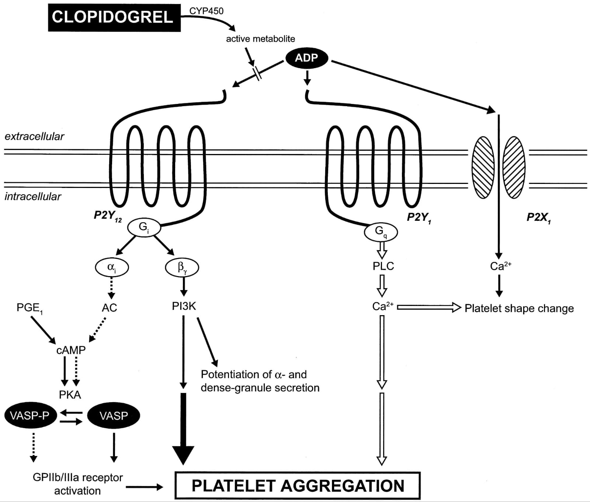
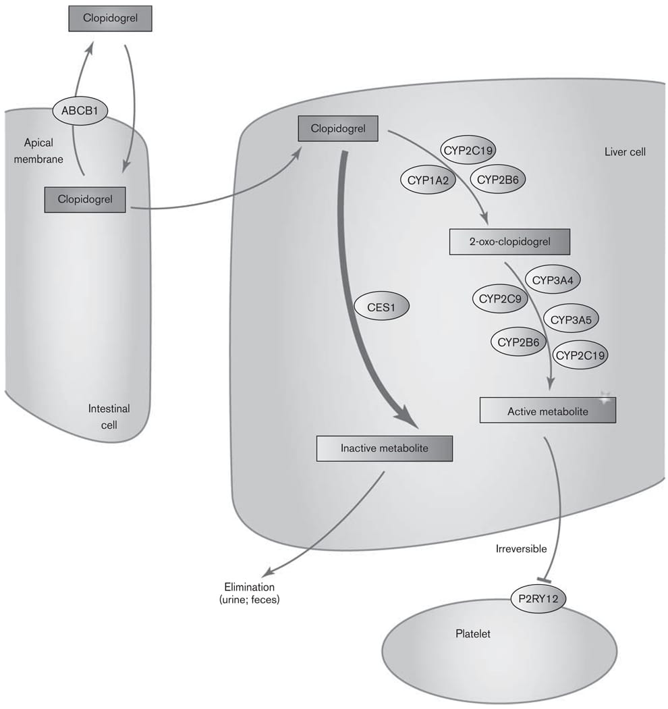
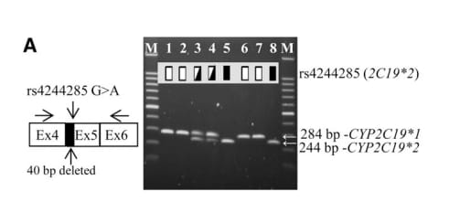
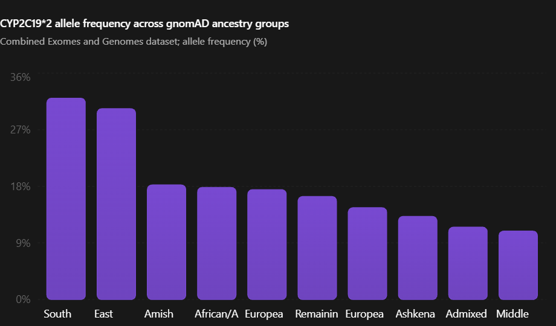
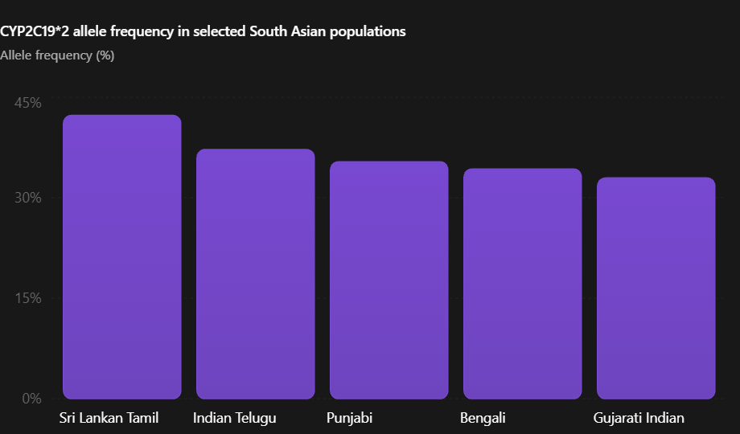
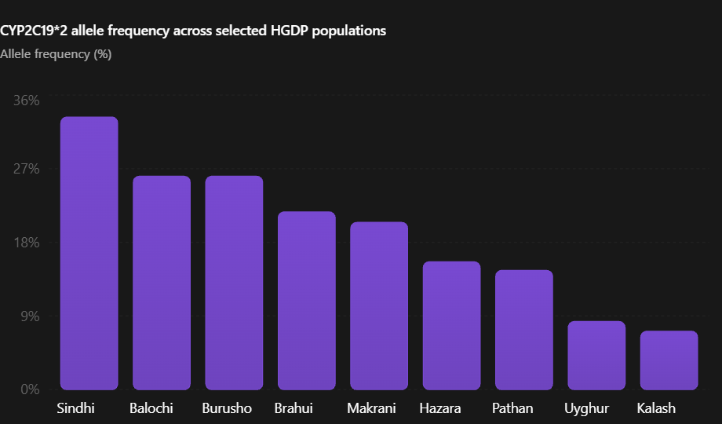

# Pharmacogenomic Analysis of CYP2C19*2 and Its Impact on Clopidogrel Response

**A study of genetic variation, population distribution and clinical implications**


---

## Overview

This research project investigates the pharmacogenomic relationship between the **CYP2C19*2 (rs4244285)** genetic variant and the antiplatelet drug **clopidogrel**.

Clopidogrel is an inactive prodrug that requires metabolic activation by cytochrome P450 enzymes, including CYP2C19. The CYP2C19*2 allele is a no-function variant associated with abnormal pre-mRNA splicing and reduced CYP2C19 enzyme activity.

This project integrates molecular genetics, population genetics and clinical pharmacogenomics to investigate how CYP2C19*2 may influence clopidogrel metabolism and therapeutic response.

## Research Objectives

- Investigate the molecular mechanism of CYP2C19*2.
- Understand the role of CYP2C19 in clopidogrel metabolic activation.
- Analyse CYP2C19*2 allele frequencies across different populations.
- Compare population-level findings from gnomAD, 1000 Genomes and HGDP.
- Examine clinical implications using CPIC pharmacogenomic recommendations.

## Research Workflow

| Stage | Investigation |
|---|---|
| 01 | Clopidogrel mechanism of action |
| 02 | CYP2C19*2 variant and abnormal RNA splicing |
| 03 | Population allele-frequency analysis |
| 04 | CYP2C19 metabolizer phenotypes |
| 05 | CPIC clinical recommendations |

## Scientific Figures

### Molecular Mechanisms

**Figure 1. Platelet activation and inhibition by clopidogrel**



**Figure 2. Metabolic activation of clopidogrel**



**Figure 3. CYP2C19*2-associated abnormal pre-mRNA splicing**



### Population Frequency Analysis

**Figure 4. CYP2C19*2 allele frequency across gnomAD ancestry groups**



**Figure 5. CYP2C19*2 allele frequency across selected South Asian populations**



**Figure 6. CYP2C19*2 allele frequency across selected HGDP populations**



## Population Analysis

Three population datasets were examined:

| Dataset | Population analysis |
|---|---|
| gnomAD | Broad genetic ancestry groups |
| 1000 Genomes | Selected South Asian populations |
| HGDP | Selected Central and South Asian populations |

### Key Findings

| Population dataset | Highest observed allele frequency |
|---|---:|
| gnomAD – South Asian | 32.03% |
| Selected South Asian – Sri Lankan Tamil | 42.35% |
| Selected HGDP – Sindhi | 33.33% |

These values represent allele frequencies, not carrier prevalence or individual clinical risk.

## Clinical Significance

CYP2C19*2 is a no-function allele. Individuals carrying CYP2C19 loss-of-function alleles may have reduced clopidogrel activation.

The 2022 CPIC guideline provides genotype-guided recommendations for selecting antiplatelet therapy, particularly in acute coronary syndrome and percutaneous coronary intervention settings.

Alternative P2Y12 inhibitors, such as prasugrel or ticagrelor, may be considered for intermediate and poor metabolizers when clinically appropriate and when no contraindications exist.

## Repository Structure

```text
cyp2c19-clopidogrel-pharmacogenomics/
│
├── README.md
├── CITATION.cff
├── LICENSE
│
├── report/
│   └── research_report.pdf
│
├── data/
│   ├── README.md
│   ├── raw/
│   └── processed/
│       ├── gnomad_frequencies.csv
│       ├── south_asian_frequencies.csv
│       └── hgdp_frequencies.csv
│
├── figures/
│   ├── mechanisms/
│   └── population/
│
└── docs/
    ├── methodology.md
    ├── references.md
    ├── variant_information.md
    └── clinical_interpretation.md
```

## Research Documentation

| Document | Description |
|---|---|
| [Research Methodology](docs/methodology.md) | Study design, population analysis and frequency calculation |
| [Variant Information](docs/variant_information.md) | CYP2C19*2 molecular characteristics and functional consequences |
| [Clinical Interpretation](docs/clinical_interpretation.md) | Clinical evidence and CPIC prescribing recommendations |
| [References and Data Sources](docs/references.md) | Scientific publications and database resources |
| [Population Data Documentation](data/README.md) | Dataset organization, data dictionary and limitations |

## Research Report

The complete research report is available here:

📄 **[Read the Pharmacogenomic Research Report](report/research_report.pdf)**

## Limitations

- Population datasets have different sampling designs and ancestry classifications.
- Small sample sizes can affect allele-frequency estimates.
- Allele frequency should not be interpreted as carrier prevalence.
- Population frequency alone cannot predict an individual's clinical response.
- Clinical interpretation requires consideration of the complete CYP2C19 diplotype and treatment context.

## References

1. Lee et al. (2022). CPIC Guideline for CYP2C19 Genotype and Clopidogrel Therapy. [DOI: 10.1002/cpt.2526](https://doi.org/10.1002/cpt.2526)
2. Mega et al. (2009). Cytochrome P-450 polymorphisms and response to clopidogrel. [DOI: 10.1056/NEJMoa0809171](https://doi.org/10.1056/NEJMoa0809171)
3. 1000 Genomes Project Consortium (2015). A global reference for human genetic variation. [DOI: 10.1038/nature15393](https://doi.org/10.1038/nature15393)
## License
This project’s original research documentation, written content, and original figures are licensed under the **Creative Commons Attribution 4.0 International (CC BY 4.0)** license.

You are free to share and adapt these materials, provided appropriate credit is given and changes are indicated.

Third-party materials, datasets, and figures remain subject to their respective licenses and terms of use.

License: https://creativecommons.org/licenses/by/4.0/
## Author

**Soumojit Ghosh**

B.Sc. Biotechnology (Honours with Research)  
St. Xavier's College (Autonomous), Burdwan  
The University of Burdwan
